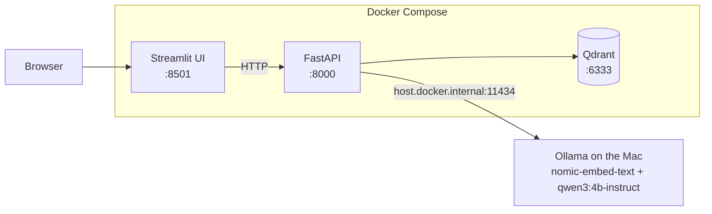
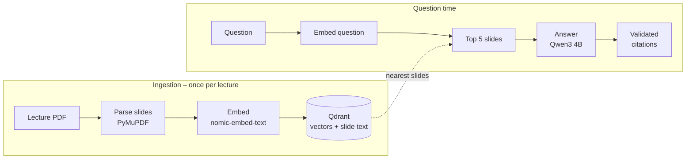

# Lecture Study Assistant (RAG)

A self-hosted assistant that answers questions about lecture slides and cites the exact deck and slide for every claim, e.g. *"Lecture 5, slide 103"*. It runs only on open models on your own machine, so the slides never leave it.

If the slides don't contain the answer, it says **"Not covered in the slides."** instead of guessing.


> **Status:** Phase 2 done – web UI, REST API and one-command start with Docker Compose. Evaluation and CI/CD are next.

## Quick start

With [Docker Desktop](https://www.docker.com/products/docker-desktop/) and [Ollama](https://ollama.com) installed:

```bash
ollama pull nomic-embed-text && ollama pull qwen3:4b-instruct
docker compose up --build
```

Open **http://localhost:8501**, upload a lecture PDF in the sidebar and ask a question.

## Example

```text
Q: What is max pooling?

Max pooling is a downsampling operation that operates over each activation map
independently, with no learnable parameters [L05-s121]. It introduces spatial
invariance to small shifts in the input [L05-s102]. A common setting uses max
pooling with a 2x2 kernel and stride 2 for 2x downsampling [L05-s103].

Sources: Lecture 5, slide 121 · Lecture 5, slide 102 · Lecture 5, slide 103

Q: What is a transformer attention mechanism?

Not covered in the slides.
```

## Architecture



Ollama runs natively instead of in a container: Docker on macOS has no GPU access, so models inside a container would run on the CPU only.

The UI contains no RAG logic – it only calls the API, so it can be replaced (e.g. by a React page) without touching the backend.

## How it works



1. **Parse** – every PDF page becomes one chunk with an ID like `L05-s12`, the lecture name and the slide number.
2. **Embed** – an encoder model turns each slide's text into a 768-dimensional vector.
3. **Store** – vectors and slide text go into Qdrant.
4. **Retrieve** – the question is embedded with the same model; Qdrant returns the 5 most similar slides (cosine similarity).
5. **Generate** – Qwen gets only the text of those slides, each labelled with its ID, and a strict prompt: answer from the slides only, cite every sentence, or say "Not covered in the slides."
6. **Validate** – the code checks the answer instead of trusting the model (see below).

### Three layers against made-up answers

| Layer | Where | What it catches |
|---|---|---|
| Score threshold | `ask.py` | Best slide's similarity below `MIN_SCORE` (0.5) → "Not covered", the LLM isn't called |
| Strict prompt | `generate.py` | Questions in the same subject that the slides don't cover |
| Citation check | `ask.py` | Slide IDs the model invented are removed; an answer with no valid citation becomes "Not covered" |

A threshold alone isn't enough: *"What is a transformer attention mechanism?"* (not in the lecture) scored 0.618, higher than *"Who were Hubel and Wiesel?"* (in the lecture) at 0.593, because both sound like deep learning.

## API

Interactive docs at **http://localhost:8000/docs**.

| Endpoint | Does |
|---|---|
| `GET /health` | Checks that Qdrant and Ollama are reachable (`503` if not) |
| `POST /documents` | Uploads a PDF, saves it to `data/` and indexes its slides |
| `POST /ask` | Answers a question with citations and the retrieved slides |

```bash
curl -X POST localhost:8000/ask -H "Content-Type: application/json" \
     -d '{"question": "What does padding do in a convolution layer?"}'
```

```json
{
  "answer": "Padding prevents feature maps from shrinking ... [L05-s78].",
  "citations": [{"slide_id": "L05-s78", "lecture": "Lecture 5", "slide": 78, "text": "..."}],
  "sources": [{"slide_id": "L05-s78", "score": 0.662}, "..."]
}
```

PDF file names must contain the lecture number, e.g. `lecture_5.pdf`. Uploading the same lecture again overwrites its slides instead of duplicating them.

## Configuration

Copy `.env.example` to `.env` to change settings; Docker Compose reads it automatically. Without Docker, the same names work as environment variables.

| Variable | Default | Used for |
|---|---|---|
| `CHAT_MODEL` | `qwen3:4b-instruct` | Answer model |
| `EMBED_MODEL` | `nomic-embed-text` | Embedding model |
| `TOP_K` | `5` | Number of slides retrieved per question |
| `MIN_SCORE` | `0.5` | Minimum similarity before the LLM is asked |
| `OLLAMA_URL` | `http://localhost:11434` | Ollama server (set by Compose) |
| `QDRANT_URL` | `http://localhost:6333` | Qdrant server (set by Compose) |
| `QDRANT_COLLECTION` | `slides` | Qdrant collection name |
| `DATA_DIR` | `data` | Where uploaded PDFs are stored |
| `API_URL` | `http://localhost:8000` | API address used by the UI (set by Compose) |

## Development without Docker

For fast reloading while coding, run only Qdrant in Docker and the rest locally (Python 3.10+):

```bash
docker compose up -d qdrant

python3.12 -m venv .venv
source .venv/bin/activate
pip install -r requirements.txt -r ui/requirements.txt

uvicorn app.api.main:app --reload    # terminal 1 → http://localhost:8000/docs
streamlit run ui/app.py              # terminal 2 → http://localhost:8501
```

Or straight from the terminal:

```bash
python -m app.ingest.index data/lecture_5.pdf
python -m app.rag.ask "What is max pooling?"
```

## Project structure

```text
app/
├── config.py          # all settings, read from environment variables
├── ingest/
│   ├── parse_pdf.py   # PDF → one chunk per slide (ID, lecture, slide, text)
│   ├── embed.py       # texts → vectors via Ollama
│   └── index.py       # parse → embed → store in Qdrant
├── rag/
│   ├── retrieve.py    # question → top-k most similar slides
│   ├── generate.py    # strict prompt with labelled slides → Qwen → answer
│   └── ask.py         # full pipeline + threshold + citation validation (CLI)
└── api/
    ├── main.py        # FastAPI endpoints
    └── schemas.py     # request and response models
ui/
└── app.py             # Streamlit UI, talks to the API over HTTP
docker/                # Dockerfiles for API and UI
docker-compose.yml     # Qdrant + API + UI
data/                  # lecture PDFs and Qdrant storage – git-ignored
```

## Tech stack

| Layer | Choice | Why |
|---|---|---|
| PDF parsing | PyMuPDF | Fast, reads text page by page, so each chunk keeps its slide number |
| Embeddings | `nomic-embed-text` via Ollama | Small BERT-style encoder, good for English technical text |
| Vector database | Qdrant | One container, simple Python client, metadata filters |
| LLM | `qwen3:4b-instruct` via Ollama | Open model, runs locally, answers without a slow "thinking" phase; switching models is one setting |
| API | FastAPI + uvicorn | Request validation and interactive docs from type hints |
| UI | Streamlit | A working web UI in about 80 lines of Python |
| Packaging | Docker Compose | One command starts the whole system |

## Design decisions

- **One chunk per slide.** Slides are already small, self-contained units, and it makes citations exact: every chunk *is* a citable slide.
- **No framework (LangChain, LlamaIndex).** The pipeline is about 150 lines of plain Python, and every step stays visible and easy to debug.
- **Slide text stored in Qdrant.** Answering a question needs only Qdrant, not the original PDFs.
- **Deterministic point IDs.** `L05-s12` is turned into the same UUID every time, so re-indexing updates instead of duplicating.
- **Don't trust the model's citations.** Small models sometimes invent slide IDs, so they're checked against the retrieved slides in code.
- **UI and API as separate services.** The API can serve other clients (curl, an eval script, a future React page), and each part has its own small Docker image.

## Known limitations

- Only text is extracted. Images, diagrams and text inside images are ignored, and image-only slides are skipped.
- Formulas may come out garbled, depending on the PDF.
- The embedding model is English-only: questions in other languages with translated technical terms find the right slides less reliably.
- The `MIN_SCORE` threshold was picked from a handful of test questions; an evaluation set will tune it properly.

## Roadmap

- [x] **Phase 1 – RAG prototype:** parse, embed, retrieve, answer with citations
- [x] **Phase 2 – API, UI, Docker Compose:** FastAPI (`/documents`, `/ask`, `/health`), Streamlit UI, one-command start
- [ ] **Phase 3 – Evaluation and CI/CD:** 30–50 test questions, Hit@5 / MRR / citation accuracy, GitHub Actions quality gate
- [ ] **Phase 4 – Kubernetes:** local cluster with manifests, probes and zero-downtime rollouts
- [ ] **Phase 5 – Monitoring:** Prometheus + Grafana (latency, tokens/s, retrieval scores)
- [ ] **Phase 6 – Extensions:** OCR / vision model for slide images, hybrid search and re-ranking, multilingual embeddings, quiz mode

## Note on lecture material

Lecture slides belong to their authors and are not part of this repository. `data/` is git-ignored; use your own slides or freely licensed material.
