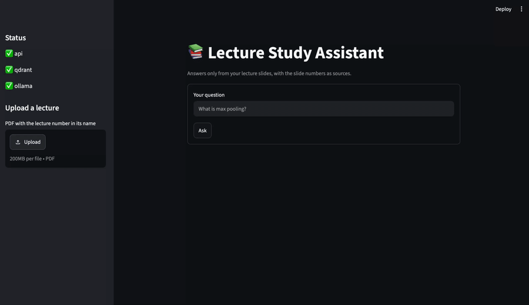
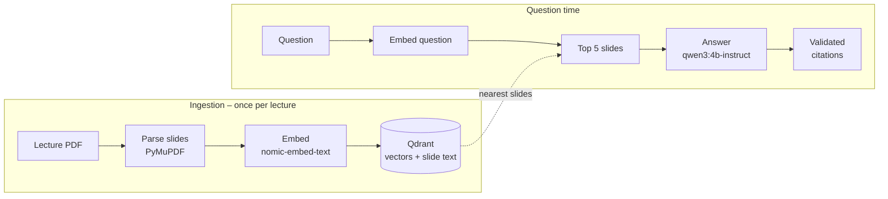
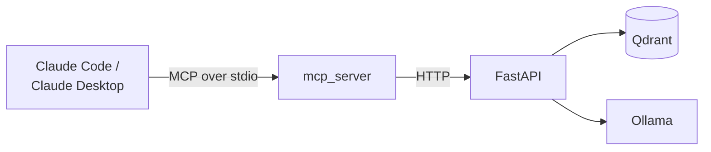
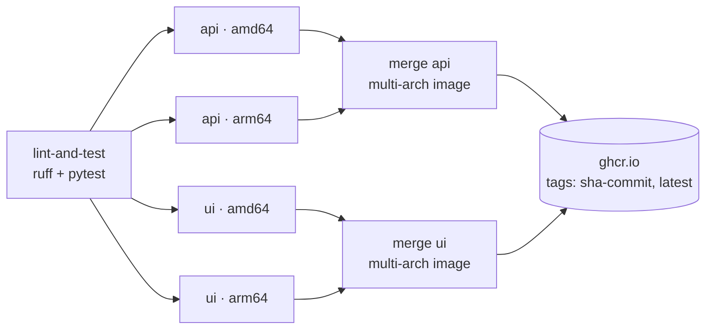
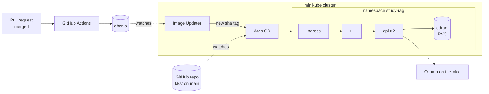
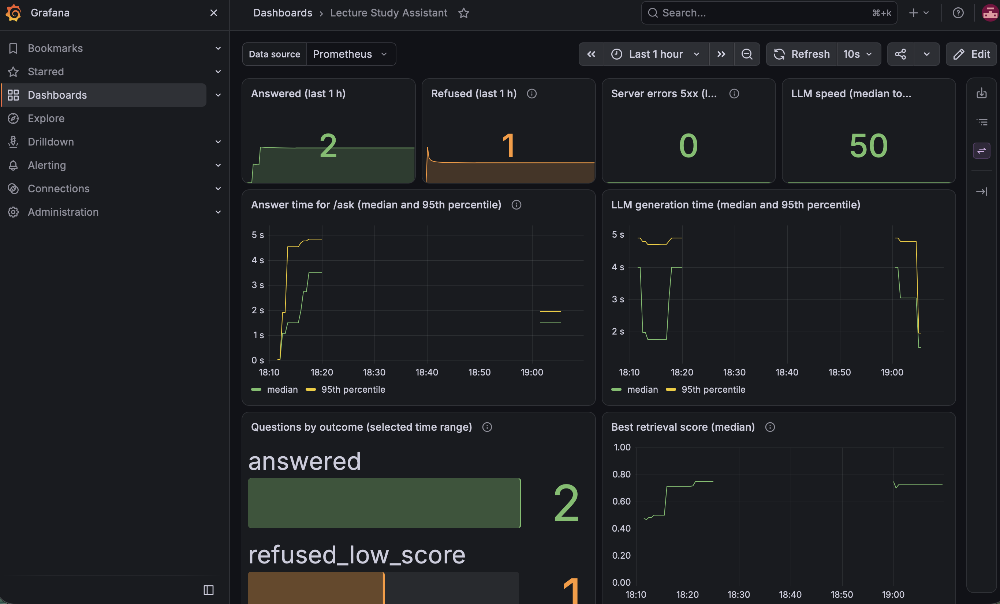

# Lecture Study Assistant (RAG)

[](https://github.com/Fezz00/study-RAG/actions/workflows/ci.yml)

A self-hosted assistant that answers questions about lecture slides and cites the exact deck and slide for every claim, e.g. *"Lecture 5, slide 103"*. It runs only on open models on your own machine, so the slides never leave it (unless you connect it to a cloud AI app through the [MCP server](#mcp-server)).

If the slides don't contain the answer, it says **"Not covered in the slides."** instead of guessing.

Besides questions, it can give a **topic overview** of a whole lecture and generate a **multiple-choice quiz** from the slides – both with the slide numbers as sources. An **MCP server** makes all of it available as tools in Claude Code or Claude Desktop.



> **Status:** Phases 1–5 done – measured with an eval set, checked by CI on every PR, deployed to Kubernetes with GitOps (merging a PR rolls out the new version automatically, without downtime), and monitored with Prometheus and Grafana. Phase 6 extensions: slide images, lecture overview, quiz mode, MCP server.

## Highlights

- **Grounded answers with citations** – retrieval with Qdrant, answers from a local Qwen model, three layers against made-up answers
- **Study modes** – a topic overview per lecture (map-reduce over all slides) and a multiple-choice quiz whose questions are self-checked before you see them
- **MCP server** – the assistant as tools for Claude Code / Claude Desktop (*"quiz me on lecture 5"*), built as a thin client of the API like the UI
- **Slide images** – an optional local vision model describes diagrams and figures, so image-only slides become searchable too
- **Measured quality** – 53-question eval set: Hit@5 0.91 (0.87 without the vision model), refusal accuracy 1.00
- **CI quality gate** – lint, 58 unit tests and multi-arch image builds (amd64 + arm64, native runners) on every PR; `main` is protected
- **Kubernetes + GitOps** – Argo CD keeps the cluster identical to `k8s/` on `main`; Argo CD Image Updater deploys every new image; zero-downtime rolling updates and self-healing
- **Monitoring** – the API exports Prometheus metrics (latency, LLM time, tokens/s, retrieval score, answer outcomes); a Grafana dashboard defined as code shows them live

## Quick start (Docker Compose)

With [Docker Desktop](https://www.docker.com/products/docker-desktop/) and [Ollama](https://ollama.com) installed:

```bash
ollama pull nomic-embed-text && ollama pull qwen3:4b-instruct
docker compose up --build
```

Open **http://localhost:8501**, upload a lecture PDF in the sidebar, then ask a question, open the lecture overview or start a quiz in the tabs.

To run it on Kubernetes instead, see [Kubernetes and GitOps](#kubernetes-and-gitops).

## Example

```text
Q: What is max pooling?

Max pooling is a downsampling operation that operates over each activation map
independently, with no learnable parameters [L05-s121]. It introduces spatial
invariance to small shifts in the input [L05-s102]. A common setting uses max
pooling with a 2x2 kernel and stride 2 for 2x downsampling [L05-s103].

Sources: Lecture 5, slide 121 · Lecture 5, slide 102 · Lecture 5, slide 103

Q: What is a transformer attention mechanism?

Not covered in the slides.
```

## How it works



1. **Parse** – every PDF page becomes one chunk with an ID like `L05-s12`. Header lines that repeat on most slides are removed, and progressive "build" slides (the same slide shown again with one more line) are skipped, so only the most complete version is indexed (lecture 5: 141 → 100 slides).
2. **Embed** – an encoder model turns each slide's text into a 768-dimensional vector.
3. **Store** – vectors and slide text go into Qdrant.
4. **Retrieve** – the question is embedded with the same model; Qdrant returns the 5 most similar slides (cosine similarity).
5. **Generate** – Qwen gets only the text of those slides, each labelled with its ID, and a strict prompt: answer from the slides only, cite every sentence, or say "Not covered in the slides."
6. **Validate** – the code checks the answer instead of trusting the model.

### Three layers against made-up answers

| Layer | Where | What it catches |
|---|---|---|
| Score threshold | `ask.py` | Best slide's similarity below `MIN_SCORE` (0.5) → "Not covered", the LLM isn't called |
| Strict prompt | `generate.py` | Questions in the same subject that the slides don't cover |
| Citation check | `ask.py` | Slide IDs the model invented are removed; an answer with no valid citation becomes "Not covered" |

A threshold alone isn't enough: *"What is a transformer attention mechanism?"* (not in the lecture) scored 0.618, higher than *"Who were Hubel and Wiesel?"* (in the lecture) at 0.593, because both sound like deep learning.

### Slide images (optional)

With `VISION_MODEL` set (e.g. `qwen3-vl:4b-instruct`, pulled with `ollama pull`), every kept slide that contains an image is rendered as a PNG and described in 2–4 sentences by the vision model. The description is added to the slide text as a `[Figure] ...` line before embedding, and slides that contain only an image are kept instead of skipped.

```bash
VISION_MODEL=qwen3-vl:4b-instruct python -m app.ingest.index data/lecture_5.pdf
```

Indexing then takes minutes instead of seconds (~6 s per image slide; lecture 5: 59 described slides), so it's off by default. Use the *instruct* (non-thinking) variant – the thinking version wrote hidden reasoning for minutes per slide.

### Lecture overview

`GET /lectures/{n}/overview` (and the **Overview** tab in the UI) lists the main topics of a lecture, each with a short summary and its slides. Questions only need the 5 closest slides, but an overview needs all of them – about 10k tokens for lecture 5, more than fits in one prompt. So it works in two steps (**map-reduce**):

1. **Map** – each batch of 15 slides is summarized into 1–4 topics.
2. **Reduce** – the topics of all batches are merged into the main topics of the lecture.

The model has to answer in a fixed JSON shape (Ollama structured output), and slide IDs it makes up are dropped, like in the citation check. Generating lecture 5 takes about 3 minutes, so the result is saved in `data/overviews/` (0.5 s afterwards) and deleted when the lecture is re-indexed.

### Quiz mode

`POST /quiz` (and the **Quiz** tab) generates multiple-choice questions from random slides of a lecture, or only from the slides about a topic (`"topic": "pooling"`; same `MIN_SCORE` guardrail as `/ask`). Every question comes from one slide and shows it as its source.

1. **Write** – the model gets one slide and must answer in a fixed JSON shape: question, 4 options, index of the correct one, explanation.
2. **Check the shape in code** – exactly 4 different options, a valid index.
3. **Shuffle** the options – a small model puts the right answer first most of the time.
4. **Self-check** – a second call gets the slide, the question and the shuffled options, but not the answer, and has to pick the answer itself. Only questions where both calls agree are kept.

The self-check matters: about half of the generated questions fail it, and the ones I looked at really were broken – e.g. *"pooling layers add weights and biases"* marked as correct while the slide says *"Number of parameters: 0"*. Grading needs no model: the correct option is known, so the UI just compares. A quiz of 5 questions takes about 50 s.

### MCP server

[MCP (Model Context Protocol)](https://modelcontextprotocol.io) is a standard way to give an AI app new tools. `mcp_server/server.py` exposes the assistant as four read-only tools:

| Tool | Calls | Does |
|---|---|---|
| `list_lectures` | `GET /lectures` | Which lectures are indexed |
| `ask_lectures` | `POST /ask` | Answer with slide citations, or "Not covered in the slides." |
| `lecture_overview` | `GET /lectures/{n}/overview` | Main topics of a lecture with their slides |
| `quiz_questions` | `POST /quiz` | Multiple-choice questions with solutions (the tool description tells the AI to hide them until you answer) |



Like the UI, it is a **thin client of the API** – the usual way to build an MCP server for an existing service. The guardrails, metrics and model calls stay in one place, MCP calls show up in Grafana like any other request, and the same server works against uvicorn or the Kubernetes deployment by changing `API_URL`. There is no upload tool on purpose: an AI assistant can read the slides, but not change what is indexed.

> **Privacy:** the app itself runs fully locally. When you use it through a cloud AI app like Claude, the tool results – answers and quotes from your slides – become part of that conversation and are sent to the AI provider. The tools cost nothing extra; the results count toward your normal usage of that app.

```bash
pip install -r mcp_server/requirements.txt
claude mcp add study-rag -e API_URL=http://localhost:8000 -- "$PWD/.venv/bin/python" "$PWD/mcp_server/server.py"
```

Then, with the API running, ask Claude e.g. *"Which lectures do I have?"* or *"Quiz me on pooling in lecture 5"*.

## Evaluation

`eval/questions.jsonl` holds 53 test questions for lecture 5: 45 with the slides that answer them (5 of them answerable only from a figure), and 8 the lecture doesn't cover. `eval/run_eval.py` runs the real pipeline on all of them.

| Metric | Measures | Result |
|---|---|---|
| **Hit@5** | Share of questions with a correct slide among the 5 retrieved | **0.911** (text only: 0.867) |
| **MRR** | How high the first correct slide ranks (1.0 = always first) | 0.773 (text only: 0.741) |
| **Citation accuracy** | Share of cited slides that are correct | ~0.94 |
| **Keyword coverage** | Share of key terms (`must_mention`) found in the answers | ~0.87 |
| **Refusal accuracy** | Not-covered questions answered with "Not covered" | **1.000** |
| **False refusal rate** | Covered questions wrongly refused | 0.125 |

Retrieval metrics are deterministic and measured on all 53 questions, with and without the vision model. The answer metrics were measured on the first 48 questions and vary by about ±0.03 between runs because of the LLM.

```bash
python -m eval.run_eval --retrieval-only   # Hit@5 + MRR in seconds, no LLM
python -m eval.run_eval                    # all metrics, ~2–3 minutes
```

The script exits with an error if Hit@5 falls below `--min-hit` (default 0.8). The eval needs the indexed lecture PDFs, which aren't public, so it runs locally before merging rather than in CI.

**What the eval showed:**
- **Switching models.** The first model, `qwen3:4b`, is a *thinking* model: it wrote ~3,500 hidden reasoning tokens before every answer (~100 s). `qwen3:4b-instruct` answers directly in ~2 s with the same scores.
- **Slide builds crowd out answers.** The misses came from near-identical slides filling the top 5. Removing headers and builds kept Hit@5 at 0.900 and made the index 29 % smaller; the remaining misses come from a worked example spread over six slides – a candidate for retrieval-time de-duplication or re-ranking.
- **Slide images help where the answer is only in a figure.** With the vision model, Hit@5 went from 0.867 to 0.911: both questions whose answer exists only in a figure were found, none without it. Questions about figures whose slide title already names the topic were found either way.
- **Grading mistakes count too.** One question was graded too strictly; fixing the test (not the system) is a separate, labelled change.

## Tests and CI

```bash
pip install -r requirements-dev.txt
ruff check .      # lint
pytest -v         # 58 unit tests, ~1 s, no Ollama or Qdrant needed
```

The unit tests cover PDF parsing (on PDFs generated in the test), slide image descriptions, citation validation, the lecture overview, quiz generation and its self-check, the API, the MCP server (real MCP calls over an in-memory connection, with a fake API behind it) and the eval helpers. Ollama is replaced by fakes, so the tests check the code around the models, not the models.

GitHub Actions ([`.github/workflows/ci.yml`](.github/workflows/ci.yml)) runs on every pull request and every push to `main`:



- Each image is built **natively** on an amd64 runner and an ARM runner (`ubuntu-24.04-arm`), in parallel – no emulation, ~1 minute per build.
- On `main`, the merge jobs join both into one **multi-arch image** on GitHub Container Registry, tagged `sha-<commit>` and `latest`.
- `main` is protected: changes only through pull requests, and lint, tests and all four image builds must pass before merging.

## Kubernetes and GitOps

The app runs on a local [minikube](https://minikube.sigs.k8s.io/) cluster. The manifests are plain Kubernetes YAML and would run on any cluster (EKS, GKE, AKS, …).



- **[`k8s/`](k8s/)** – Deployments, Services, a PersistentVolumeClaim for Qdrant, a ConfigMap for settings and an Ingress, tied together with Kustomize.
- **Zero-downtime updates** – the API runs 2 replicas with `maxUnavailable: 0`; a new pod gets traffic only after its readiness probe (`/health`) passes.
- **Two kinds of probes** – readiness checks Qdrant and Ollama; liveness only checks that the server process answers, so an Ollama outage doesn't make Kubernetes restart a healthy API.
- **[`gitops/`](gitops/)** – Argo CD watches `k8s/` on `main` with automated sync, prune and self-heal. Argo CD Image Updater watches ghcr.io for new `sha-…` tags and passes them to Argo CD directly, so it never commits to the protected `main` branch.

**Result:** merging a pull request is the only deploy step. A few minutes later the new version runs in the cluster, and manual changes to the cluster are reverted automatically.

### Run it

Requires Docker Desktop, [minikube](https://minikube.sigs.k8s.io/), `kubectl`, [Helm](https://helm.sh) and Ollama running on the Mac.

```bash
# 1. Cluster: minikube profile, ingress addon, namespace, ghcr.io pull secret (asks for a token with read:packages)
./scripts/cluster-up.sh

# 2. Host names (once)
echo "127.0.0.1 study-rag.local api.study-rag.local argocd.study-rag.local grafana.study-rag.local" | sudo tee -a /etc/hosts

# 3. Tunnel to the ingress (own terminal, keep it open)
minikube tunnel -p study-rag

# 4. Argo CD + Image Updater; registers the app and the monitoring stack – from here on Argo CD deploys them
./scripts/gitops-up.sh
```

| URL | |
|---|---|
| http://study-rag.local | UI – upload a lecture PDF first (the cluster has its own Qdrant) |
| http://api.study-rag.local/docs | API |
| http://argocd.study-rag.local | Argo CD (user `admin`, password printed by `gitops-up.sh`) |
| http://grafana.study-rag.local | Grafana (user `admin`, password: `kubectl -n monitoring get secret monitoring-grafana -o jsonpath='{.data.admin-password}' \| base64 -d`) |

## Monitoring



The API measures itself with [prometheus-client](https://github.com/prometheus/client_python) and serves the numbers at `/metrics`:

| Metric | Type | Shows |
|---|---|---|
| `http_request_duration_seconds` | histogram | latency per endpoint and status code (5xx = errors) |
| `llm_generation_seconds` | histogram | how long Qwen takes to write an answer |
| `llm_tokens_per_second` | histogram | generation speed, from Ollama's own token counts |
| `retrieval_top_score` | histogram | similarity of the best slide per question |
| `rag_answers_total{outcome}` | counter | `answered`, or which layer refused: `refused_low_score`, `refused_by_model`, `refused_no_citation` |

- **Prometheus and Grafana** come from the `kube-prometheus-stack` Helm chart, installed and kept up to date by Argo CD as a second Application ([`gitops/monitoring.yaml`](gitops/monitoring.yaml), chart version pinned).
- **A ServiceMonitor** ([`k8s/servicemonitor.yaml`](k8s/servicemonitor.yaml)) tells Prometheus to read the API's `/metrics` every 15 seconds – inside the cluster. `/metrics` is not exposed through the ingress.
- **The dashboard is code** ([`k8s/dashboards/study-rag.json`](k8s/dashboards/study-rag.json)): a ConfigMap labelled `grafana_dashboard: "1"`, loaded by Grafana automatically and changed through pull requests like everything else.

**What the dashboard answers, in order:** are there errors (5xx on user requests)? Is it slow – and is it the LLM (compare answer time with generation time)? Are answers getting worse (outcomes, retrieval score)? The built-in Kubernetes dashboards show CPU and memory per pod.

**Lesson from tuning it:** the first version counted the readiness probe's `/health` 503s (sent while Ollama was stopped) as server errors and showed "11 errors" although no user request had failed. Errors now count only user-facing endpoints.

## API

Interactive docs at `/docs` (http://localhost:8000/docs with Compose, http://api.study-rag.local/docs on Kubernetes).

| Endpoint | Does |
|---|---|
| `GET /health` | Checks that Qdrant and Ollama are reachable (`503` if not) |
| `POST /documents` | Uploads a PDF, saves it and indexes its slides |
| `POST /ask` | Answers a question with citations and the retrieved slides |
| `GET /lectures` | Lists the indexed lectures with their number of slides |
| `POST /quiz` | Multiple-choice questions from a lecture, optionally about a topic (`count` 1–10) |
| `GET /lectures/{n}/overview` | Main topics of a lecture with their slides (`?refresh=true` generates it again) |
| `GET /metrics` | Prometheus metrics (on Kubernetes only reachable inside the cluster) |

```bash
curl -X POST localhost:8000/ask -H "Content-Type: application/json" \
     -d '{"question": "What does padding do in a convolution layer?"}'
```

```json
{
  "answer": "Padding prevents feature maps from shrinking ... [L05-s78].",
  "citations": [{"slide_id": "L05-s78", "lecture": "Lecture 5", "slide": 78, "text": "..."}],
  "sources": [{"slide_id": "L05-s78", "score": 0.662}, "..."]
}
```

PDF file names must contain the lecture number, e.g. `lecture_5.pdf`. Uploading the same lecture again replaces its slides.

## Configuration

All settings are environment variables. Docker Compose reads them from `.env` (see `.env.example`); on Kubernetes they come from the ConfigMap in `k8s/configmap.yaml`.

| Variable | Default | Used for |
|---|---|---|
| `CHAT_MODEL` | `qwen3:4b-instruct` | Answer model |
| `EMBED_MODEL` | `nomic-embed-text` | Embedding model |
| `VISION_MODEL` | *(empty = off)* | Vision model that describes slide images while indexing |
| `TOP_K` | `5` | Number of slides retrieved per question |
| `MIN_SCORE` | `0.5` | Minimum similarity before the LLM is asked |
| `OLLAMA_URL` | `http://localhost:11434` | Ollama server |
| `QDRANT_URL` | `http://localhost:6333` | Qdrant server |
| `QDRANT_COLLECTION` | `slides` | Qdrant collection name |
| `DATA_DIR` | `data` | Where uploaded PDFs and saved lecture overviews are stored |
| `API_URL` | `http://localhost:8000` | API address used by the UI |

## Development without Docker

For fast reloading while coding, run only Qdrant in Docker and the rest locally (Python 3.10+):

```bash
docker compose up -d qdrant

python3.12 -m venv .venv
source .venv/bin/activate
pip install -r requirements-dev.txt -r ui/requirements.txt

uvicorn app.api.main:app --reload    # terminal 1 → http://localhost:8000/docs
streamlit run ui/app.py              # terminal 2 → http://localhost:8501
```

Or straight from the terminal:

```bash
python -m app.ingest.index data/lecture_5.pdf
python -m app.rag.ask "What is max pooling?"
python -m app.rag.overview 5
python -m app.rag.quiz 5 "pooling"
```

## Project structure

```text
app/
├── config.py          # all settings, read from environment variables
├── metrics.py         # Prometheus metrics definitions
├── ingest/
│   ├── parse_pdf.py   # PDF → one chunk per slide (headers and slide builds removed)
│   ├── describe.py    # slide image → text description via a vision model (optional)
│   ├── embed.py       # texts → vectors via Ollama
│   └── index.py       # parse → embed → store in Qdrant (replaces a lecture on re-index)
├── rag/
│   ├── retrieve.py    # question → top-k most similar slides; all slides of a lecture
│   ├── generate.py    # strict prompt with labelled slides → Qwen → answer
│   ├── ask.py         # full pipeline + threshold + citation validation (CLI)
│   ├── overview.py    # map-reduce summary of a whole lecture, saved in data/overviews/
│   └── quiz.py        # multiple-choice questions from slides, with a self-check
└── api/
    ├── main.py        # FastAPI endpoints
    └── schemas.py     # request and response models
mcp_server/server.py   # MCP server: the API as tools for Claude, a thin HTTP client like the UI
ui/app.py              # Streamlit UI (Ask, Overview, Quiz tabs), talks to the API over HTTP
eval/                  # eval questions + scoring script
tests/                 # unit tests (pytest)
docker/                # Dockerfiles for API and UI
docker-compose.yml     # Qdrant + API + UI
k8s/                   # Kubernetes manifests (Kustomize) – what Argo CD deploys
└── dashboards/        # Grafana dashboard JSON
gitops/                # Argo CD values, Applications (app + monitoring) and ImageUpdater
scripts/               # cluster-up.sh, gitops-up.sh
.github/workflows/     # CI: lint, tests, multi-arch image builds
data/                  # lecture PDFs and Qdrant storage – git-ignored
```

## Tech stack

| Layer | Choice | Why |
|---|---|---|
| PDF parsing | PyMuPDF | Fast, reads text page by page, so each chunk keeps its slide number |
| Embeddings | `nomic-embed-text` via Ollama | Small BERT-style encoder, good for English technical text |
| Vector database | Qdrant | One container, simple Python client, metadata filters |
| LLM | `qwen3:4b-instruct` via Ollama | Open model, runs locally, answers without a slow "thinking" phase |
| Vision (optional) | `qwen3-vl:4b-instruct` via Ollama | Small local vision model for slide figures; non-thinking, so seconds per slide |
| MCP server | Official `mcp` Python SDK (v2), stdio transport | The standard protocol for giving AI apps tools; type hints become the tool schemas |
| API / UI | FastAPI + uvicorn / Streamlit | Validation and interactive docs from type hints / a web UI in plain Python |
| Packaging | Docker, Docker Compose | One command starts the whole system |
| CI | GitHub Actions, ruff, pytest, GHCR | Quality gate on every PR, multi-arch images on every merge |
| Deployment | Kubernetes (minikube), Kustomize, Helm | Portable manifests; Helm installs Argo CD |
| GitOps | Argo CD + Argo CD Image Updater | Pull-based deployment, self-healing, no cluster credentials in CI |
| Monitoring | Prometheus + Grafana (kube-prometheus-stack) | The standard Kubernetes monitoring stack; dashboards as code |

## Design decisions

- **One chunk per slide.** Slides are already small, self-contained units, and it makes citations exact: every chunk *is* a citable slide.
- **No framework (LangChain, LlamaIndex).** The pipeline is about 150 lines of plain Python, and every step stays visible and easy to debug.
- **Don't trust the model's citations.** Small models sometimes invent slide IDs, so they're checked against the retrieved slides in code.
- **Don't trust the model's JSON either.** Overview and quiz use structured output (the reply must match a JSON schema), and the code still checks it: invented slide IDs are dropped, and every quiz question must survive a second, independent answer.
- **UI and API as separate services.** The API can serve other clients (curl, the eval script, a future React page), and each part has its own small image.
- **Eval locally, tests in CI.** The lecture PDFs must stay private, so CI runs fast unit tests and the eval runs on the developer machine.
- **Pull-based GitOps.** The local cluster isn't reachable from GitHub, and pull-based deployment needs no cluster credentials in CI. Argo CD reaches out to GitHub instead.
- **Image updates without commits.** Image Updater writes new tags to Argo CD instead of Git, which keeps `main` protected (PR + CI required). Trade-off: the exact running tag lives in Argo CD, not in Git.
- **Native multi-arch builds.** The Mac cluster is arm64, GitHub's default runners are amd64; building each on its own runner is ~5× faster than QEMU emulation.

## Known limitations

- Slide images are only described when `VISION_MODEL` is set; indexing then takes minutes instead of seconds, and the descriptions can contain small mistakes.
- The embedding model is English-only: questions in other languages with translated technical terms find the right slides less reliably.
- The eval set covers one lecture.
- The quiz self-check catches a wrong answer key, but not a small wrong detail inside the correct option (e.g. a filter size of 3x3 instead of 5x5).
- The image pull secret is created by hand (`cluster-up.sh`), not stored in Git; a production setup would use Sealed Secrets or External Secrets.
- Ollama runs outside the cluster on the host, because Docker on macOS has no GPU access.

## Roadmap

- [x] **Phase 1 – RAG prototype:** parse, embed, retrieve, answer with citations
- [x] **Phase 2 – API, UI, Docker Compose:** FastAPI, Streamlit UI, one-command start
- [x] **Phase 3 – Evaluation and CI/CD:** eval set (now 53 questions), Hit@5 / MRR / citation and refusal metrics, GitHub Actions quality gate, images on GHCR
- [x] **Phase 4 – Kubernetes and GitOps:** manifests with probes and zero-downtime rollouts, ingress, Argo CD + Image Updater
- [x] **Phase 5 – Monitoring:** `/metrics` in the API, Prometheus + Grafana via Argo CD, dashboard as code
- [x] **Phase 6 – Study features:** vision model for slide images, topic overview per lecture, quiz mode
- [x] **Phase 6 – MCP server:** the assistant as read-only tools for Claude Code / Claude Desktop
- [ ] **Next:** Langfuse (per-question tracing), Terraform (same stack on a cloud cluster), hybrid search and re-ranking
- [ ] **Later:** Redis (answer cache, chat history), security hardening (auth, rate limits, NetworkPolicies)

## Note on lecture material

Lecture slides belong to their authors and are not part of this repository. `data/` is git-ignored; use your own slides or freely licensed material.
