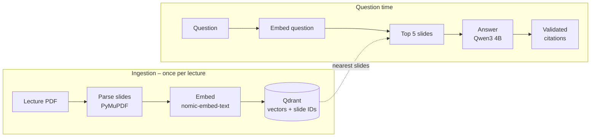

# Lecture Study Assistant (RAG)

A self-hosted assistant that answers questions about lecture slides and cites the exact deck and slide for every claim, e.g. *"Lecture 5, slide 103"*. It runs only on open models on your own machine, so the slides never leave it.

If the slides don't contain the answer, it says **"Not covered in the slides."** instead of guessing.

> **Status:** Phase 1 (RAG prototype) done – works from the terminal. API, web UI and Docker Compose are next.

## Example

```text
$ python -m app.rag.ask "What is max pooling?"
Max pooling is a downsampling operation that operates over each activation map
independently, with no learnable parameters [L05-s121]. It introduces spatial
invariance to small shifts in the input [L05-s102]. A common setting uses max
pooling with a 2x2 kernel and stride 2 for 2x downsampling [L05-s103].

Sources:
  Lecture 5, slide 121
  Lecture 5, slide 102
  Lecture 5, slide 103

$ python -m app.rag.ask "What is a transformer attention mechanism?"
Not covered in the slides.
```

## How it works



1. **Parse** – every PDF page becomes one chunk with an ID like `L05-s12`, the lecture name and the slide number.
2. **Embed** – an encoder model turns each slide's text into a 768-dimensional vector.
3. **Store** – vectors and slide text go into Qdrant.
4. **Retrieve** – the question is embedded with the same model; Qdrant returns the 5 most similar slides (cosine similarity).
5. **Generate** – Qwen gets only those slides, each labelled with its ID, and a strict prompt: answer from the slides only, cite every sentence, or say "Not covered in the slides."
6. **Validate** – the code checks the answer instead of trusting the model (see below).

### Three layers against made-up answers

| Layer | Where | What it catches |
|---|---|---|
| Score threshold | `ask.py` | Best slide's similarity below `MIN_SCORE` (0.5) → "Not covered", the LLM isn't called |
| Strict prompt | `generate.py` | Questions in the same subject that the slides don't cover |
| Citation check | `ask.py` | Slide IDs the model invented are removed; an answer with no valid citation becomes "Not covered" |

A threshold alone isn't enough: *"What is a transformer attention mechanism?"* (not in the lecture) scored 0.618, higher than *"Who were Hubel and Wiesel?"* (in the lecture) at 0.593, because both sound like deep learning.

## Tech stack

| Layer | Choice | Why |
|---|---|---|
| PDF parsing | PyMuPDF | Fast, reads text page by page, so each chunk keeps its slide number |
| Embeddings | `nomic-embed-text` via Ollama | Small BERT-style encoder, good for English technical text |
| Vector database | Qdrant (Docker) | One container, simple Python client, metadata filters |
| LLM | `qwen3:4b` via Ollama | Open model, runs locally; switching models is one setting |

## Getting started

### Prerequisites

- macOS with [Homebrew](https://brew.sh)
- Python 3.10+ (`brew install python@3.12`)
- [Docker Desktop](https://www.docker.com/products/docker-desktop/)
- [Ollama](https://ollama.com) (`brew install ollama`)

### 1. Start the services

```bash
# Ollama runs natively on the Mac (Docker on macOS has no GPU access)
ollama serve                      # keep this terminal open
ollama pull nomic-embed-text
ollama pull qwen3:4b

# Qdrant runs in Docker, data is stored in data/qdrant/
docker run -d --name qdrant -p 6333:6333 -v "$(pwd)/data/qdrant:/qdrant/storage" qdrant/qdrant
# later: docker start qdrant
```

### 2. Install the project

```bash
python3.12 -m venv .venv
source .venv/bin/activate
pip install -r requirements.txt
```

### 3. Index a lecture

Put a PDF in `data/` with the lecture number in its file name (e.g. `data/lecture_5.pdf`):

```bash
python -m app.ingest.index data/lecture_5.pdf
```

Indexing the same lecture again overwrites its slides instead of duplicating them. Browse the stored slides at http://localhost:6333/dashboard.

### 4. Ask a question

```bash
python -m app.rag.ask "What does padding do in a convolution layer?"
```

### Configuration

All settings are environment variables with local defaults:

| Variable | Default | Used for |
|---|---|---|
| `OLLAMA_URL` | `http://localhost:11434` | Ollama server |
| `EMBED_MODEL` | `nomic-embed-text` | Embedding model |
| `CHAT_MODEL` | `qwen3:4b` | Answer model |
| `QDRANT_URL` | `http://localhost:6333` | Qdrant server |
| `QDRANT_COLLECTION` | `slides` | Qdrant collection name |
| `MIN_SCORE` | `0.5` | Minimum similarity before the LLM is asked |

Example: `CHAT_MODEL=qwen3:8b python -m app.rag.ask "..."`

## Project structure

```text
app/
├── ingest/
│   ├── parse_pdf.py   # PDF → one chunk per slide (ID, lecture, slide, text)
│   ├── embed.py       # texts → vectors via Ollama
│   └── index.py       # parse → embed → store in Qdrant
└── rag/
    ├── retrieve.py    # question → top-k most similar slides
    ├── generate.py    # strict prompt with labelled slides → Qwen → answer
    └── ask.py         # full pipeline + threshold + citation validation (CLI)
data/                  # lecture PDFs and Qdrant storage – git-ignored
```

## Design decisions

- **One chunk per slide.** Slides are already small, self-contained units, and it makes citations exact: every chunk *is* a citable slide.
- **No framework (LangChain, LlamaIndex).** The pipeline is about 150 lines of plain Python, and every step stays visible and easy to debug.
- **Slide text stored in Qdrant.** Answering a question needs only Qdrant, not the original PDFs.
- **Deterministic point IDs.** `L05-s12` is turned into the same UUID every time, so re-indexing updates instead of duplicating.
- **Don't trust the model's citations.** Small models sometimes invent slide IDs, so they're checked against the retrieved slides in code.

## Known limitations

- Only text is extracted. Images, diagrams and text inside images are ignored, and image-only slides are skipped.
- Formulas may come out garbled, depending on the PDF.
- The `MIN_SCORE` threshold was picked from a handful of test questions; an evaluation set will tune it properly.

## Roadmap

- [x] **Phase 1 – RAG prototype:** parse, embed, retrieve, answer with citations
- [ ] **Phase 2 – API, UI, Docker Compose:** FastAPI (`/documents`, `/ask`, `/health`), Streamlit UI, one-command start
- [ ] **Phase 3 – Evaluation and CI/CD:** 30–50 test questions, Hit@5 / MRR / citation accuracy, GitHub Actions quality gate
- [ ] **Phase 4 – Kubernetes:** local cluster with manifests, probes and zero-downtime rollouts
- [ ] **Phase 5 – Monitoring:** Prometheus + Grafana (latency, tokens/s, retrieval scores)
- [ ] **Phase 6 – Extensions:** OCR / vision model for slide images, hybrid search and re-ranking, quiz mode

## Note on lecture material

Lecture slides belong to their authors and are not part of this repository. `data/` is git-ignored; use your own slides or freely licensed material.
